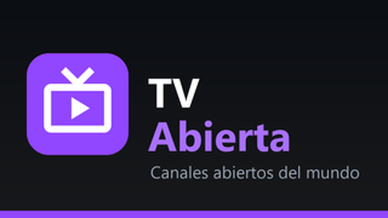
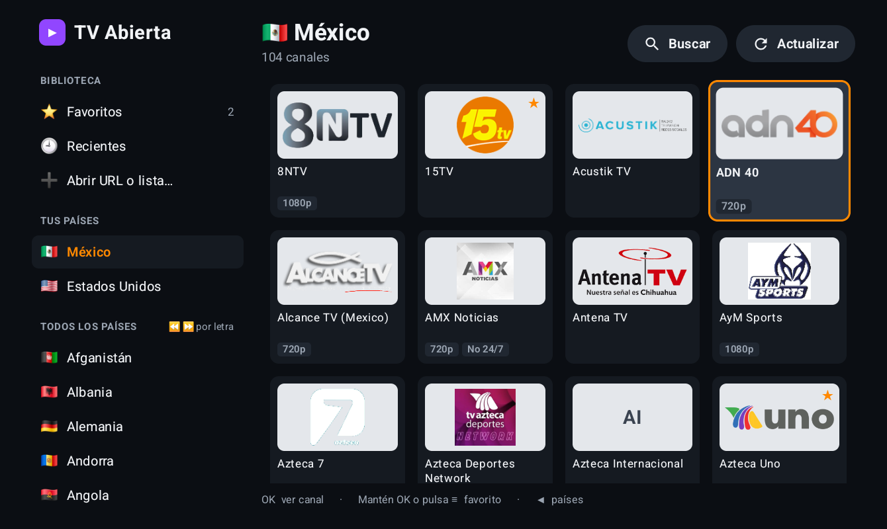
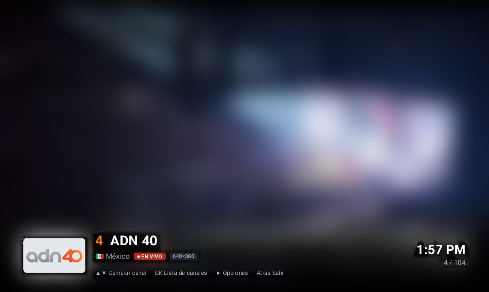
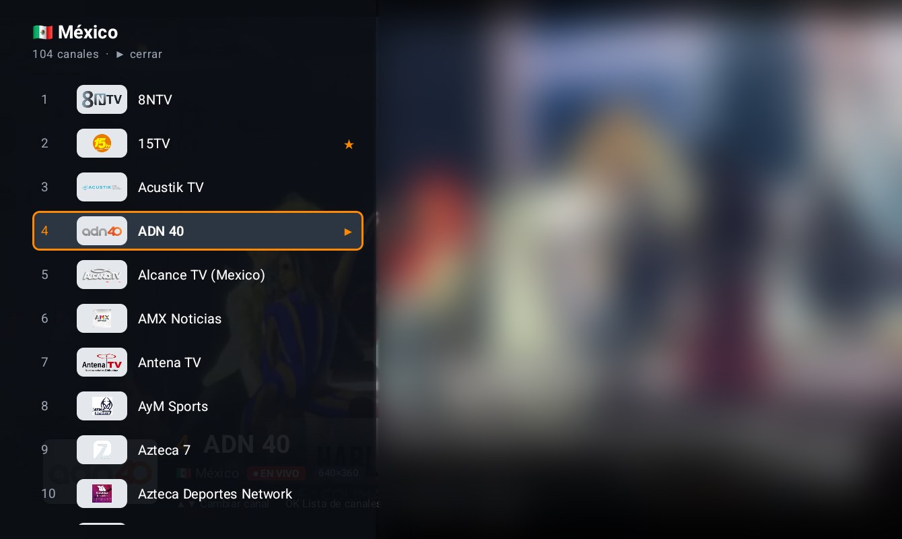
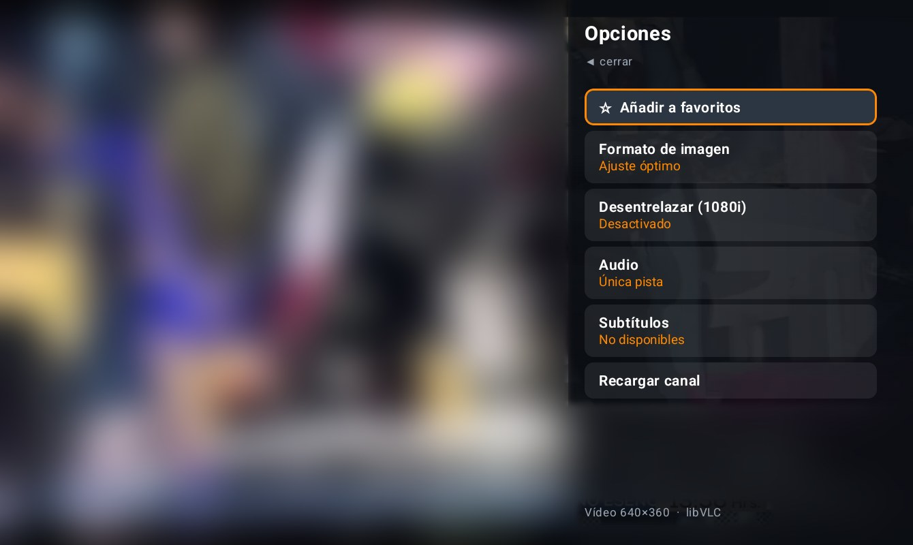

<p align="center"></p>

# TV Abierta

Reproductor de TV en vivo para **Fire TV / Firestick** (y cualquier Android TV, tablet o teléfono), hecho con el
motor de **VLC (libVLC)** y las listas de canales abiertos de
[Romaxa55/world_ip_tv](https://github.com/Romaxa55/world_ip_tv), que se revisan automáticamente varias veces al día.

Eliges un país, eliges un canal y lo ves. Con ▲▼ cambias de canal como en una tele.

## Capturas

<table>
<tr>
<td align="center" width="50%"><br><b>Inicio</b><br><sub>Países a la izquierda, canales del país elegido a la derecha</sub></td>
<td align="center" width="50%"><br><b>Reproductor</b><br><sub>▲▼ cambia de canal; la barra muestra número, hora y resolución real</sub></td>
</tr>
<tr>
<td align="center" width="50%"><br><b>Lista de canales</b><br><sub>OK abre la lista sin dejar de ver el canal</sub></td>
<td align="center" width="50%"><br><b>Opciones</b><br><sub>Favorito, formato de imagen, desentrelazado, audio y subtítulos</sub></td>
</tr>
</table>

<sub>El video de fondo está desenfocado en las capturas.</sub>

## Qué hace

- **236 países y territorios** (más "Internacional") con nombre en español y bandera; los que usas quedan arriba en *Tus países*.
- **Cuadrícula de canales** con logo, calidad (720p, 1080p…) y avisos *No 24/7* / *Geo* (bloqueo regional).
- **Reproductor libVLC** con decodificación por hardware: HLS (m3u8), TS, RTSP, RTMP, UDP, etc.
- **Zapping**: ▲▼ cambia de canal al instante; la barra inferior muestra número, nombre, hora y resolución real.
- **Lista de canales lateral** (OK) y **menú de opciones** (▶): favorito, formato de imagen, desentrelazado,
  pista de audio, subtítulos y recargar.
- **Favoritos** y **Recientes**.
- **Abrir URL o lista…**: como el "Abrir flujo de red" de VLC: reproduce cualquier flujo o guarda tu propia lista M3U
  (admite `#EXTVLCOPT`, `http-user-agent`, `http-referrer` y cabeceras estilo Kodi `url|User-Agent=…`).
- **Búsqueda** de canales sin importar acentos.
- Las listas se guardan en el dispositivo: si GitHub o internet fallan, ves la última copia.
- Otras apps pueden abrir flujos/listas con TV Abierta ("Abrir con…").

## Control remoto

| Pantalla | Botón | Acción |
|---|---|---|
| Inicio | ◀ ▶ ▲ ▼ | Moverse entre países y canales |
| Inicio | OK | Ver canal / elegir país |
| Inicio | Mantener OK o ≡ | Añadir o quitar de favoritos (en una lista guardada: quitarla) |
| Inicio | ⏪ ⏩ | Saltar por letra en la lista de países |
| Reproductor | ▲ ▼ | Canal anterior / siguiente |
| Reproductor | OK o ◀ | Lista de canales |
| Reproductor | ▶ o ≡ | Opciones |
| Reproductor | ⏯ | Pausa |
| Reproductor | Atrás | Cerrar panel / volver a la lista |

## Instalar en el Firestick

1. En el Fire TV: **Configuración → Mi Fire TV → Opciones para desarrolladores** y activa
   **Depuración ADB** y **Apps de origen desconocido**.
   Si no ves *Opciones para desarrolladores*: **Mi Fire TV → Acerca de** y pulsa 7 veces sobre el nombre del dispositivo.
2. Busca la IP del Fire TV en **Mi Fire TV → Acerca de → Red** (por ejemplo `192.168.1.50`).
   El PC y el Fire TV deben estar en la misma red.
3. En Windows, desde la carpeta del proyecto (compila el APK si hace falta y lo instala):

   ```powershell
   .\instalar-firestick.ps1 -Ip 192.168.1.50
   ```

   La primera vez el Fire TV pregunta si permites la depuración desde ese equipo: elige **Permitir** (marca
   "Permitir siempre") y vuelve a ejecutar el comando si hizo falta.

   Con otro sistema, compila (ver abajo) y usa `adb connect <ip>:5555` y `adb install -r app-release.apk`.

La app aparece en **Tus apps y canales** (al final de la fila; puedes moverla al inicio).

## Compilar

Requiere JDK 17 (`JAVA_HOME`) y el Android SDK con la plataforma 36 (ruta en `local.properties` o `ANDROID_HOME`).

```powershell
.\gradlew.bat :app:assembleRelease      # APK en app\build\outputs\apk\release\app-release.apk
.\gradlew.bat :app:testDebugUnitTest    # pruebas del lector M3U
```

El APK release se firma con la clave de depuración local, para instalarlo directamente en tus dispositivos.
Incluye libVLC para ARM de 32 y 64 bits (Firesticks y tablets), por eso pesa ~45 MB.

El ícono y el banner de Fire TV se generan con `python tools/make_icons.py app/src/main/res`.

## Cómo está hecho

| Archivo | Qué hace |
|---|---|
| `data/Countries.kt` | Lista de países de world_ip_tv, nombres en español y banderas |
| `data/M3uParser.kt` | Lee listas M3U extendidas (logo, calidad, etiquetas, opciones de VLC) |
| `data/PlaylistRepository.kt` | Descarga las listas y guarda copia local (se renueva cada 6 h) |
| `data/LibraryStore.kt` | Favoritos, recientes, listas propias y preferencias |
| `player/VlcController.kt` | Envoltura de libVLC: reproducir, eventos, pistas, formato de imagen |
| `ui/browser/` | Pantalla de países y canales, diálogos |
| `ui/player/PlayerScreen.kt` | Reproductor a pantalla completa, zapping, paneles |

Kotlin + Jetpack Compose, libVLC 3.7, OkHttp y Coil. Mínimo Android 6 (Fire OS 6 o superior).

## Preguntas

**Veo un canal en VLC pero no lo encuentro en la app.**
VLC a veces muestra el nombre de la estación que viene dentro del stream (por ejemplo *WSCV*), mientras que la app
usa el nombre de la lista (*Telemundo East HD*). Prueba **Buscar** con el nombre de la cadena. Además, world_ip_tv
solo publica los canales de [iptv-org](https://github.com/iptv-org/iptv) que pasan su comprobación automática
(en EE. UU., unos 950 de ~1 470), así que un canal puede faltar algunos días. Si quieres la lista completa, agrégala
con **Abrir URL o lista…**, por ejemplo `https://iptv-org.github.io/iptv/countries/us.m3u`.

**Un canal no carga o se ve negro.**
Son transmisiones públicas de terceros: algunas solo funcionan desde su país (*Geo*), a ciertas horas (*No 24/7*)
o están caídas. Cambia con ▲▼.

## Notas

- La app no aloja ni distribuye video: solo reproduce las listas públicas de world_ip_tv / iptv-org o las que agregues.
- *Desentrelazar* sirve para canales 1080i con "efecto peine"; usa más CPU, así que déjalo apagado si no lo necesitas.
- libVLC se distribuye bajo LGPL 2.1.
